<!-- Generated by scripts/build.py from data/profile.json. Edit those, not this file. -->

<h1><picture><source media="(prefers-color-scheme: dark)" srcset="assets/header-dark.svg"><source media="(prefers-color-scheme: light)" srcset="assets/header-light.svg"></picture></h1>

<a href="https://www.linkedin.com/in/habibsoula"><picture><source media="(prefers-color-scheme: dark)" srcset="assets/link-linkedin-dark.svg"><source media="(prefers-color-scheme: light)" srcset="assets/link-linkedin-light.svg"></picture></a>
<a href="mailto:habibsoulapro@gmail.com"><picture><source media="(prefers-color-scheme: dark)" srcset="assets/link-email-dark.svg"><source media="(prefers-color-scheme: light)" srcset="assets/link-email-light.svg"></picture></a>

I own products from the first client call to the release: the data model, the Flutter app, the TypeScript backend and the deploy. At **Value Digital Services** I build banking, insurance and HR apps for the BIAT group and its clients. As an independent engineer I build event platforms, booking agents and data pipelines for clients in Tunisia, France and Dubai.

Most of that code is private client work. The numbers above count it, and the sections below describe it.

## Experience

<picture><source media="(prefers-color-scheme: dark)" srcset="assets/career-dark.svg"><source media="(prefers-color-scheme: light)" srcset="assets/career-light.svg"></picture>

Career timeline as text

**Value Digital Services — Software Engineer** (Feb 2023 – now)

- 2026-01: **BIAT Jeune — youth banking platform**. Flutter app on 16 Spring Boot microservices in Kubernetes. Keycloak OTP login, Redis sessions.
- 2025-01: **VEEP — white-label HR platform**. Newsfeed, timesheets and leave requests. A client rebrands it with one design-token file.
- 2023-07: **ESPRIT — engineering degree in computer science**. Master's level, Tunis.
- 2023-02: **Dima Maak — insurance app for Assurances BIAT**. The official app of the BIAT insurance group, live on the App Store and Google Play.

**Independent — Full-stack & AI Engineer** (Nov 2024 – now)

- 2026-06: **Tunrooms — AI booking agent**. Live on tunrooms.com. Answers renters from 619 real listings and never invents a result.
- 2025-12: **Focale OS — platform for medical congresses**. Multi-tenant, one subdomain per event. Pricing engine, abstracts → peer review → PDF book.
- 2025-11: **B2B lead pipeline — France**. 1.2M electricity addresses distilled into 74K scored companies, joined with legal data.
- 2024-11: **EON — fitness studio platform, Dubai**. Sole engineer: Flutter app, Next.js admin, NestJS + Postgres. Onboarding 2 weeks → 2 days.

## Selected work

<picture><source media="(prefers-color-scheme: dark)" srcset="assets/card-budgywell-dark.svg"><source media="(prefers-color-scheme: light)" srcset="assets/card-budgywell-light.svg"></picture>
<a href="https://github.com/HabibPro1999/focale-backend/tree/develop"><picture><source media="(prefers-color-scheme: dark)" srcset="assets/card-focale-dark.svg"><source media="(prefers-color-scheme: light)" srcset="assets/card-focale-light.svg"></picture></a>

<a href="https://github.com/HabibPro1999/shiplog"><picture><source media="(prefers-color-scheme: dark)" srcset="assets/card-shiplog-dark.svg"><source media="(prefers-color-scheme: light)" srcset="assets/card-shiplog-light.svg"></picture></a>
<a href="https://github.com/HabibPro1999/liquid_glass"><picture><source media="(prefers-color-scheme: dark)" srcset="assets/card-liquid-dark.svg"><source media="(prefers-color-scheme: light)" srcset="assets/card-liquid-light.svg"></picture></a>

<a href="https://github.com/can1357/oh-my-pi/pull/916"><picture><source media="(prefers-color-scheme: dark)" srcset="assets/card-ohmypi-dark.svg"><source media="(prefers-color-scheme: light)" srcset="assets/card-ohmypi-light.svg"></picture></a>
<a href="https://github.com/HabibPro1999/fatoura-cli"><picture><source media="(prefers-color-scheme: dark)" srcset="assets/card-fatoura-dark.svg"><source media="(prefers-color-scheme: light)" srcset="assets/card-fatoura-light.svg"></picture></a>

Also shipped: private client work

| Project | What it is | Stack |
| --- | --- | --- |
| **CRM Énergie** | Self-hosted CRM for a French energy broker: AI invoice OCR with human review, e-signature mandates, telephony, row-level security per role | React 19 · NestJS · PostgreSQL · BullMQ |
| **Ayplan** | Booking backend for a tourism and events operator: Konnect payments, outbox worker, 123 test files, OpenAPI snapshot test | NestJS · Fastify · Drizzle |
| **Qidzy** | Learning app for children: in-app purchases, golden tests, Arabic and English | Flutter · NestJS · CockroachDB |
| **Ezzou** | Course platform monorepo where API contract drift fails the frontend build | NestJS · Next.js 15 · Vite |

## How I ship

<picture><source media="(prefers-color-scheme: dark)" srcset="assets/ship-dark.svg"><source media="(prefers-color-scheme: light)" srcset="assets/ship-light.svg"></picture>

I use coding agents every day, and I treat their output like a pull request from a new teammate: specified first, reviewed twice, merged only when the checks pass. The public version of this loop is [assay, a Claude Code skill](https://github.com/HabibPro1999/assay).

## Open source

| Project | What it does | Stack |
| --- | --- | --- |
| [oh-my-pi #916](https://github.com/can1357/oh-my-pi/pull/916) | Merged. On-demand BM25 tool discovery for a coding agent with 35k stars (+1,927 −338) | TypeScript |
| [oh-my-pi #833](https://github.com/can1357/oh-my-pi/pull/833) | Merged. Provider response extension hook (+351 −19) | TypeScript |
| [shiplog](https://github.com/HabibPro1999/shiplog) | AI coding sessions to one HTML file. Install with `brew install HabibPro1999/tap/shiplog` | Go |
| [assay](https://github.com/HabibPro1999/assay) | Claude Code skill: from a vague request to merge-ready code, with machine-owned gates | Agent skill |
| [liquid_glass](https://github.com/HabibPro1999/liquid_glass) | Liquid Glass surfaces for Flutter: GLSL shaders, SDF shapes, fallbacks | Dart · GLSL |
| [fatoura-cli](https://github.com/HabibPro1999/fatoura-cli) | PDF invoices for Tunisian freelancers, from the terminal or a local web UI | Python |
| [claude-collab](https://github.com/HabibPro1999/claude-collab) | Ask a teammate's Claude Code session a question. Published on npm | TypeScript |
| [team-monitor](https://github.com/HabibPro1999/team-monitor) | Live dashboard for Claude Code agent teams | Bun · React |
| [dart_modernizer](https://github.com/HabibPro1999/dart_modernizer) | Codemod to new Dart features; the analyzer re-checks every edit | Dart |

## Stack

| Area | Tools |
| --- | --- |
| Mobile | Flutter, Dart, Riverpod, Bloc, Stacked, drift (SQLite), GLSL shaders |
| Backend | TypeScript, NestJS, Fastify, Bun, Spring Boot, Java, Go, Rust |
| Data | PostgreSQL with row-level security, Drizzle, Prisma, CockroachDB, Redis, BullMQ, Firebase |
| Web | React, Next.js, Vite, Astro, Tailwind CSS, shadcn/ui, Refine |
| Infra | Docker, Kubernetes, Caddy, GitHub Actions, AWS, Cloudflare R2, Sentry |
| AI | Claude Code, Codex, MCP servers, RAG with pgvector, LLM APIs, n8n |

<picture><source media="(prefers-color-scheme: dark)" srcset="assets/languages-dark.svg"><source media="(prefers-color-scheme: light)" srcset="assets/languages-light.svg"></picture>

## Contact

Open to new projects. Write to me at [habibsoulapro@gmail.com](mailto:habibsoulapro@gmail.com) or send a message on [LinkedIn (in/habibsoula)](https://www.linkedin.com/in/habibsoula).

---

The panels on this page are rendered by [scripts/build.py](scripts/build.py) from [data/profile.json](data/profile.json), and a GitHub Actions workflow refreshes the numbers every day. Data as of 2026-10-14.
